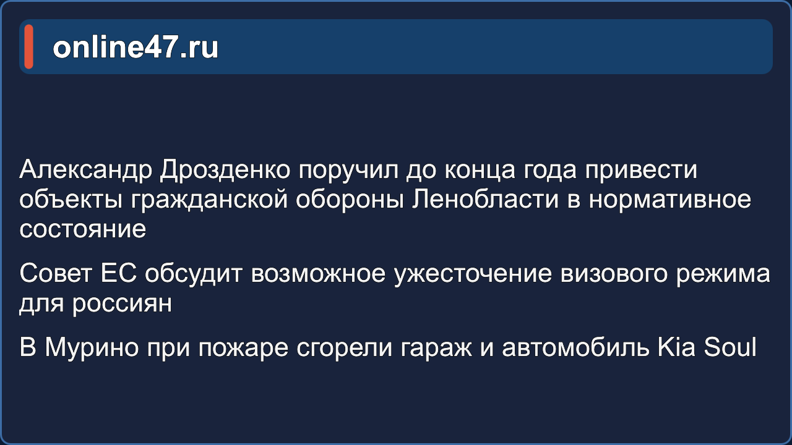
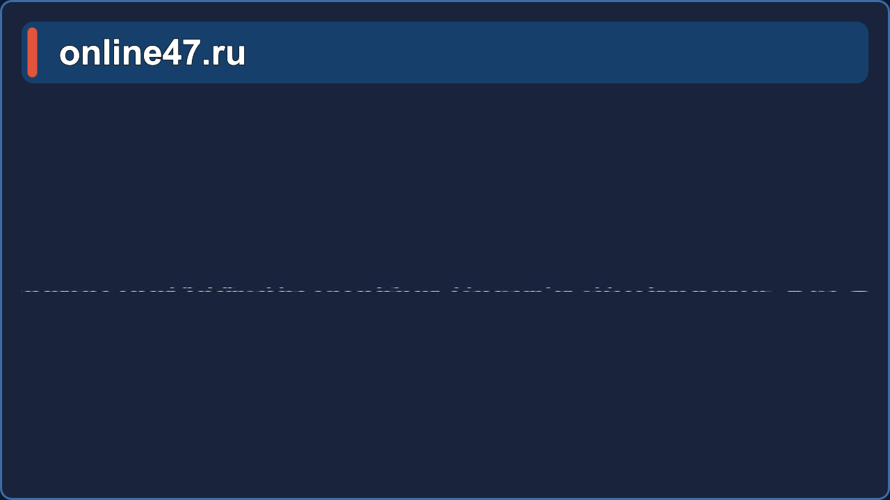

# 📰 NewsRoll — постраничный показ новостей для «Форвард Т»


Титровальный элемент QML для ПО «Форвард Т» (FDTitle Designer / FDOnAir,
СофтЛаб-НСК): постраничный показ новостных сообщений из текстового файла
(по мотивам скрипт-объекта TS1_NewsRollCrawl). Родственный проект —
[WeatherRoll](https://github.com/AlexNova69/WeatherRoll) (полноэкранная погода).

| Заставка | Страница новостей | Смена страниц |
|:---:|:---:|:---:|
|  |  |  |

## Возможности

* 📄 Новости из текстового файла: первая строка до `#` игнорируется (комментарий),
  строки `#Заголовок` начинают блок новостей, предложения — постранично
  (3 предложения на страницу, настраивается);
* 🔁 Смена страниц: **переворот (flip)** или **слайд** влево/вправо/вверх/вниз;
* 🏁 **Без кольца**: после последней страницы показ завершается — скрипт
  паркуются на статичной заставке и «заканчивает работу» (`loopPlayback`
  по умолчанию `false`);
* 🅿️ **Всегда с заставки**: при снятии с эфира (и по завершении показа)
  элемент заранее паркуется на заставке, поэтому КАЖДОЕ включение
  начинается мгновенно с заставки и первой страницы — без «огрызка»
  недоигранной страницы и без накопления сдвига между показами;
* 🎨 **Настраиваемая заставка**: свой текст (`splashText` — например
  «НОВОСТИ ПИКАЛЁВО»), логотип-картинка вместо пульсирующего кольца
  (`splashLogoUrl`) и фоновая картинка (`splashBackgroundUrl`); при
  ошибке загрузки картинок всё откатывается к умолчанию;
* 🎬 Заставка: **видео** (`introVideoUrl` — точно по схеме WeatherRoll,
  с автоматическим откатом на статическую «НОВОСТИ», если мультимедиа
  недоступно) либо статическая (`splashDurationMs`). Длина видео
  автоматически учитывается в длительности цикла;
* 📡 **Каждое включение — с заставки**: рестарт по статусу эфира
  включён ВСЕГДА (ровно как в WeatherRoll — `SLRunTime.statusElement`);
* 📊 **Индикатор-самописец** в углу панели (включён по умолчанию,
  `showDebugOverlay = false` в ini — выключить): живое состояние
  «стр. 1/6 · слот 9000 · прошло 2.3 с · ранних срабатываний: N»
  и длительность цикла — видно прямо в эфире;
* 🕐 **Все паузы — на часах анимации** (PauseAnimation, не Timer): в моде
  «Файл» FDOnAir готовит кадры по контентному времени, и обычные таймеры
  «съедали» время показа — теперь длительности верны в обеих модах;
* ⏱ **Жёсткие слоты**: время страницы = слот «от появления до появления
  следующей», включая переход. Одно СМИ из 5 строк = 9 с + 9 с = 18 с
  ровно. Длительность печатается в консоль дизайнера при каждом выходе
  в эфир;
* ⚙️ Все настройки — в **NewsRoll.ini** рядом со скриптом (без правки QML),
  с комментарием у каждого параметра; перечитываются вместе с новостями;
* 🔄 Автоперечитывание файла новостей (`reloadIntervalMs`) — правки текста
  появляются в эфире без перезапуска.

## Формат файла новостей

Кодировка UTF-8 или UTF-16 (с BOM):

```
#online47.ru
Александр Дрозденко поручил до конца года привести объекты ГО в нормативное состояние
Совет ЕС обсудит возможное ужесточение визового режима для россиян
В Мурино при пожаре сгорели гараж и автомобиль Kia Soul
#Следующий источник
Новость первая
Новость вторая
```

Каждый блок `#Заголовок` разбивается на страницы по 3 предложения; заголовок
держится в верхней полосе, пока показываются новости своего блока.
Пример — [пикалево.txt](пикалево.txt).

## Быстрый старт

1. Скопируйте `NewsRoll.qml`, `NewsRoll.ini` в папку проекта.
2. В FDTitle Designer добавьте элемент **QML**, в поле «Анимация» укажите
   `NewsRoll.qml`, в поле «Задание» — файл новостей. Мода проигрывания —
   любая: «Файл» или «Реальное время» (все выдержки идут по часам анимации
   и не искажаются при заблаговременной подготовке кадров).
3. Настройте времена/цвета в `NewsRoll.ini` (или прямо в QML, блок «НАСТРОЙКИ»).
4. Длительность цикла скрипт печатает в консоль дизайнера при старте показа —
   впишите её в поле «Длительность» элемента для расписания FDAir3, либо
   включите у элемента «Зациклить задание» (Loop).

## Настройки (NewsRoll.ini)

| Ключ | Назначение |
|---|---|
| `newsFileUrl` | файл новостей (`file:///D:/...`) |
| `showTimeFirstMs` / `showTimeRestMs` | время показа первой / следующих страниц, мс |
| `splashDurationMs` | заставка, мс (0 — выключить; вкл. 3000..8000) |
| `splashText` | свой текст заставки (по умолчанию «НОВОСТИ») |
| `splashLogoUrl` / `splashBackgroundUrl` | логотип и фон заставки (картинки) |
| `splashTextColor` | цвет текста заставки |
| `transitionStyle` | `flip` \| `slideLeft` \| `slideRight` \| `slideUp` \| `slideDown` |
| `transitionDurationMs` | длительность эффекта смены, мс |
| `headerSwapMs` | скорость смены заголовка `#...`, мс |
| `loopPlayback` | показ по кругу (по умолчанию `false` — после последней страницы показ завершается, парковка на заставке) |
| `sentencesOnFirstPage` / `sentencesOnNextPage` | предложений на странице (по умолчанию 3) |
| `reloadIntervalMs` | период перечитывания новостей и ini, мс (0 — выкл.) |
| `fontFamily`, `enableOutline`, цвета | оформление (`panelColor`, `headerBgColor`, `accentColor`, …) |

Правила ini: `ключ = значение ; пояснение` (пустое значение — берётся из QML),
true/false — `1/0`/`да/нет`, цвета — `#AARRGGBB`, пути — с прямыми слэшами.

## Производительность, моды проигрывания и замена файлов

* **Архитектура времени — в точности как в WeatherRoll** (проверена этим
  же движком в эфире): выдержки страниц и заставка — обычные Timer по
  настенным часам, без дебаунса и парковки. После последней страницы
  показ завершается — элемент замерзает на последней странице.

### Как добиться «каждое включение — с заставки»

Причина обоих повторявшихся сбоев — мода **«Файл»** (у QML-элемента она
по умолчанию!): движок готовит клип, прогоняя живой QML, и во время
подготовки статус элемента читается как «Running» — из-за этого рестарт
по статусу портил запись (первая страница обрезалась до ~1 с); а
подготовленный клип между включениями продолжает проигрываться с
сохранённой позиции (второе включение показывало замороженную последнюю
страницу). Два рабочих варианта:

**Вариант А (рекомендуемый, как у WhetherRoll):**
1. В FDTitle Designer у элемента NewsRoll выставьте моду
   **«Реальное время»** (после пересоздания элемента мода сбрасывается
   на «Файл» — проверяйте каждый раз!);
2. В `NewsRoll.ini` добавьте строку `useStatusRestart = true` —
   каждое включение стартует с заставки.

**Вариант Б (мода «Файл»):** перед каждым `<titleon>` в расписании
перезагружайте задание — движок пересоздаст клип, и показ начнётся
с начала:

```xml
<titleload target="NewsRoll" value="d:\project\newsroll\пикалево.txt" />
<titleabort target="NewsRoll" />
<titleon target="NewsRoll" duration="00:00:57.00" />
```

Окно `duration` ставьте равным циклу (см. индикатор/журнал скрипта):
окно длиннее цикла — в конце показа будут секунды замороженной
последней страницы.

В любом варианте: файлы скрипта заменяйте только при остановленном
OnAir3 — движок наблюдает папку проекта (`DirectoryPool … Changed`) и
перезапись на живом движке переводит элемент в `Invalid`.
* **Защита времени по настенным часам**: FDOnAir при включении титула
  может «разгонять» событийный цикл QML, и таймер страницы срабатывает
  по движковому времени раньше положенного — из-за этого первая страница
  переворачивалась через ~1 секунду (в Дизайнере — нормальный цикл,
  поэтому там всё верно). Теперь таймеры страниц и заставки сверяются с
  `Date.now()`: преждевременное срабатывание ловится, страница
  додерживается остаток (каждый случай пишется в консоль, счётчик виден
  на экранном индикаторе);
* Опрос статуса эфира — одно дешёвое чтение `SLRunTime.statusElement`
  раз в 250 мс — без `hasOwnProperty` (перечисление свойств C++-обёртки
  вызывает тяжёлые геттеры движка: в журнале FDOnAir это выглядело как
  `ISLTMTitleRunTime4.get_TaskFileName()` по 300–1100 мс и
  `Watchdog timeout`);
* `useInjectedTask` (по умолчанию `false`) — не включайте без проверки:
  каждая проба имён контекста читает свойства движка;
* Длина цикла печатается в консоль при каждом выходе в эфир и видна на
  экранном индикаторе (`showDebugOverlay = true` в ini);
* **Замена файлов скрипта на сервере**: FDOnAir наблюдает папку проекта
  (в журнале — `DirectoryPool … Changed`) и перезагружает титр «на лету».
  Копируйте новые `NewsRoll.qml`/`NewsRoll.ini` при остановленном OnAir3,
  либо сразу после копирования перезагрузите титровальный проект
  (`Set title config`). Перезапись файлов на работающем движке ловит
  состояния `State (None->Invalid)` и ломает показ;
* Если в эфире цикл всё равно «схлопывается» (заставка → страница на
  пару секунд → снова заставка) — проверьте поле **«Длительность»**
  элемента в FDTitle Designer: закешированное неверное значение (~6 с)
  режет показ. Лечение: пересоздать элемент в титровальном объекте
  (удалить и заново добавить QML-элемент, указать Задание и Анимацию) —
  движок перемерит длительность свежим скриптом. Заодно сравните с
  элементом WhetherRoll.

## Внешний QML-процесс и RPC (важно для эксплуатации)

Титровальные элементы QML живут в **отдельном процессе** и общаются с
FDOnAir3 по COM/RPC. В журнале это видно по `CSLQMLElement` и, при
проблемах, по `_com_error … Сервер RPC недоступен` на вызовах
`RealStop/Abort`. Что из этого следует:

* Живой QML-экземпляр может «жить» сутками (`realDuration="23:04:18"` в
  отчётах) — он прогоняет цикл один раз и дальше стоит на последней
  странице. Перезапуск объекта делает команда расписания **`titleload`**
  (загрузка задания) — ставьте её перед каждым `titleon`:
  ```xml
  <titleload target="NewsRoll" value="d:\project
ewsroll\пикалево.txt" />
  <titleabort target="NewsRoll" />
  <titleon target="NewsRoll" duration="00:00:57.00" />
  ```
* Если в журнале появились «Сервер RPC недоступен» — внешний QML-процесс
  потерял связь с движком, команды к элементам не доходят. Лечится
  только перезапуском FDOnAir3. После этого проверьте, что показ пошёл;
* Скрипт не «дёргает» движок без необходимости: опрос статуса — раз в
  500 мс (каждое чтение `SLRunTime.statusElement` — межпроцессный
  вызов; частый опрос перегружает RPC-связь).

## Состав

```
NewsRoll\
├── NewsRoll.qml    титровальный элемент (все настройки внутри)
├── NewsRoll.ini    настройки — правятся здесь, без QML
├── пикалево.txt    пример файла новостей
└── screenshots/    кадры показа
```

## Лицензия

MIT. Совместимо с Qt 5.6+ (проверено на Qt 5.6.2 из состава ForwardT) и Qt 6.
